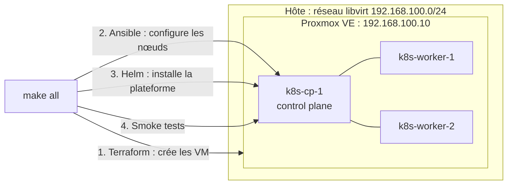

# Homelab

[](LICENSE)


Un cluster Kubernetes self-hosted entièrement décrit en code, qu'une seule commande reconstruit et teste de bout en bout en environ 7 minutes.

<!--  -->

## Pourquoi ce projet

Ce homelab sert à pratiquer l'exploitation d'une plateforme dans des conditions proches de la production : tout est versionné, reproductible et vérifié automatiquement. Le critère de réussite est simple : `make destroy && make all` doit aboutir sans aucune intervention manuelle.

À terme, la plateforme sera déployée en GitOps, supervisée et durcie (voir [État d'avancement](#état-davancement)). Aujourd'hui, elle couvre le provisionnement des VM, la configuration des nœuds, l'installation du cluster et ses tests de validation.

## Architecture



Proxmox tourne dans une VM sur le réseau NAT défini par [`libvirt/homelab.xml`](libvirt/homelab.xml). Les nœuds Kubernetes sont donc des VM imbriquées.

## Stack

| Couche | Outil | Version | Rôle |
|---|---|---|---|
| Virtualisation | Proxmox VE | – | Héberge les VM du cluster |
| Provisionnement | Terraform, provider `bpg/proxmox` | ≥ 1.6, `~> 0.119.0` | Crée les VM et génère l'inventaire Ansible |
| Configuration | Ansible | – | Prépare les nœuds et les durcit (SSH par clé uniquement, mises à jour de sécurité automatiques) |
| Runtime | containerd | Paquet Debian | Exécute les conteneurs |
| Orchestration | Kubernetes (kubeadm) | 1.36 | 1 control plane, 2 workers |
| Réseau de pods | Calico | v3.33.0 | CNI, encapsulation VXLAN |
| LoadBalancer | MetalLB (mode L2) | 0.16.1 | Attribue les IP `192.168.100.200-220` |
| Stockage | local-path-provisioner | v0.0.37 | `StorageClass` par défaut |
| Qualité | pre-commit | – | yamllint, ansible-lint, `terraform validate`, gitleaks |

## État d'avancement

- [x] **Phase 1 : Fondation** : Infrastructure as Code, Linux, Kubernetes
- [ ] **Phase 2 : CI/CD et GitOps** : pipelines, conteneurs, déploiement continu *(en cours)*
- [ ] **Phase 3 : Observabilité** : métriques, logs, alerting
- [ ] **Phase 4 : Sécurité** : réseau, identité, secrets, politiques, sauvegardes
- [ ] **Phase 5 : Exploitation** : incidents, runbooks, restauration

## Prérequis

**Sur le poste de travail :** `terraform` (≥ 1.6), `ansible-core`, `helm`, `kubectl`, `direnv` et `make`. Une version récente d'`ansible-core` est nécessaire pour la collection `community.general` : celle d'apt peut être trop ancienne, préférez `pipx install --include-deps ansible-core`.

**Sur Proxmox :**

- Un template de VM Debian cloud-init avec `qemu-guest-agent` installé (ID `9000` par défaut).
- Un jeton d'API Terraform dont le rôle autorise la gestion des VM, y compris `VM.GuestAgent.Audit` sur Proxmox VE 9.
- Un bridge `vmbr0` et un datastore `local-lvm`.

**Ressources allouées aux VM :** 6 vCPU, 16 Go de RAM et 200 Go de disque au total.

## Démarrage rapide

```bash
# 1. Créer la clé SSH attendue par l'inventaire
ssh-keygen -t ed25519 -f ~/.ssh/homelab

# 2. Renseigner le jeton Proxmox, puis charger les variables
cp .envrc.example .envrc
direnv allow

# 3. Décrire les nœuds, avec des IP situées dans le sous-réseau du bridge (192.168.100.x par défaut)
cp terraform/proxmox/terraform.tfvars.example terraform/proxmox/terraform.tfvars

# 4. Construire et tester le cluster
make all

# 5. Utiliser le cluster
export KUBECONFIG="$PWD/kubeconfig"
kubectl get nodes -o wide
```

Le réseau est défini à plusieurs endroits. Pour utiliser un autre sous-réseau, adaptez :

- `terraform/proxmox/variables.tf`
- `terraform/proxmox/terraform.tfvars`
- `ansible/group_vars/k8s_cluster.yml`
- `k8s/platform/metallb/pool.yaml`

## Commandes

| Commande | Action |
|---|---|
| `make all` | Enchaîne `infra`, `configure`, `platform` et `test` |
| `make infra` | Crée les VM avec Terraform et génère l'inventaire |
| `make configure` | Configure les nœuds et initialise le cluster avec Ansible |
| `make platform` | Installe Calico, MetalLB et le stockage |
| `make test` | Lance les smoke tests |
| `make destroy` | Détruit toutes les VM du cluster et supprime le `kubeconfig` |

> [!WARNING]
> `make all` et `make destroy` lancent Terraform avec `-auto-approve`. `make destroy` supprime les VM **sans demander de confirmation**.

## Validation

`make test` exécute [`scripts/smoke-test.sh`](scripts/smoke-test.sh), qui vérifie que :

1. les trois nœuds sont `Ready` ;
2. le DNS interne résout les services ;
3. un service `LoadBalancer` obtient une IP MetalLB et répond en HTTP ;
4. un pod peut écrire sur un volume persistant.

Les ressources de test sont supprimées à la fin, même en cas d'échec.

## Structure du dépôt

```text
.
├── terraform/proxmox/   # VM du cluster et génération de l'inventaire
├── ansible/             # Rôles common, containerd, kubernetes, kubeadm_init, kubeadm_join
├── k8s/platform/        # Valeurs Helm et manifestes de la plateforme
├── k8s/tests/           # Manifestes utilisés par les smoke tests
├── libvirt/             # Réseau NAT de l'hôte
├── scripts/             # Installation de la plateforme et smoke tests
├── docs/                # Runbooks
└── Makefile             # Point d'entrée
```

## Limites connues

- **Pas de haute disponibilité :** il n'y a qu'un seul control plane.
- **Stockage non répliqué :** avec `local-path`, un volume reste lié à son nœud.
- **TLS Proxmox non vérifié :** Terraform accepte le certificat autosigné (`insecure = true`).
- **Taille du cluster figée dans les tests :** les smoke tests attendent exactement trois nœuds.
- **Fonctions à venir :** le GitOps, la supervision et les sauvegardes ne sont pas encore en place.

Ce dépôt est un environnement de lab : il n'est pas prévu pour exposer des services sur Internet en l'état.


## Licence

Code distribué sous licence [GPL-3.0](LICENSE).
